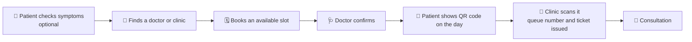
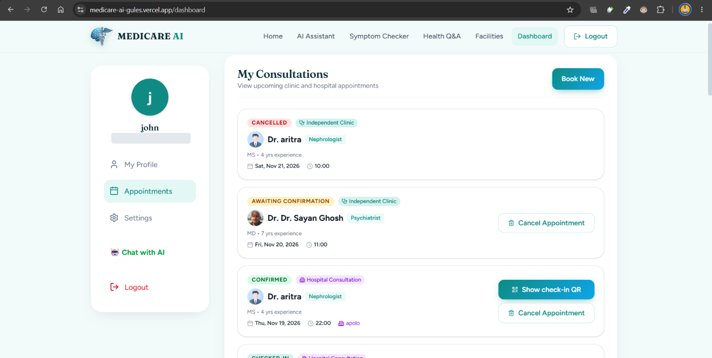
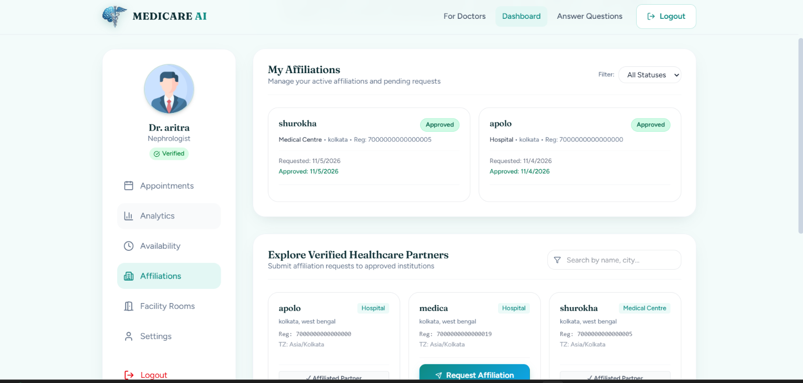
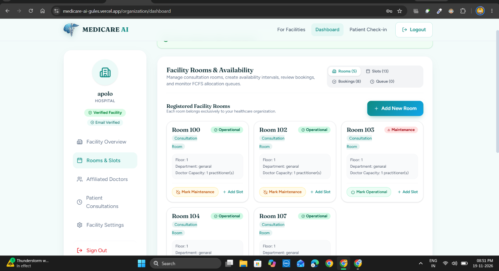
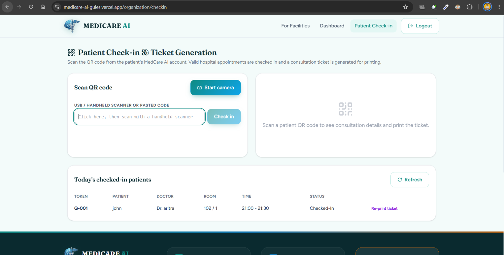
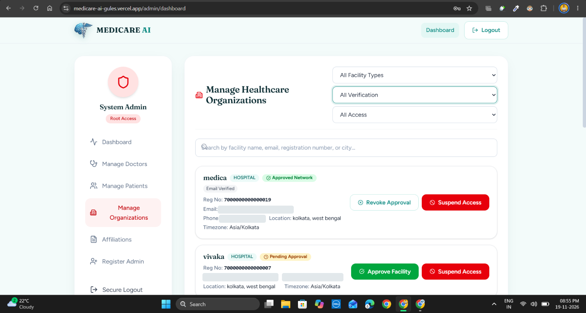

# 🏥 MEDICARE AI

**Affordable practice and facility management for independent doctors and small healthcare organizations, with AI-guided patients delivered to their door.**

[🌐 Live demo](https://medicare-ai-gules.vercel.app/) &nbsp;·&nbsp; [🩺 For doctors](https://medicare-ai-gules.vercel.app/doctor) &nbsp;·&nbsp; [🏢 For facilities](https://medicare-ai-gules.vercel.app/organization)

 

---

## 📑 Contents

[The Problem](#-the-problem) · [The Solution](#-the-solution) · [Business Motive](#-business-motive) · [Features](#-features) · [How a Visit Works](#-how-a-visit-works) · [Screenshots](#-screenshots) · [Tech](#-technology) · [Roadmap](#-roadmap) · [Disclaimer](#-disclaimer) · [License](#-license-and-usage) · [Author](#-author)

---

## 🎯 The Problem

Large hospitals have software to run appointments, rooms and doctors. Smaller providers usually do not.

| 😟 Who struggles | ❌ What goes wrong |
|---|---|
| 🏢 **Small clinics and hospitals** | Management software is too expensive, so they rely on paper registers, phone calls and messages |
| 🩺 **Independent doctors** | Time goes into scheduling and records instead of patients, and new patients cannot easily find them |
| 🧑 **Patients** | Hard to find a doctor who is actually available and to get a confirmed slot |
| 📋 **Everyone** | Manual scheduling causes double bookings, empty slots and extra admin work |

## 💡 The Solution

> **MediCare AI is one platform that connects patients, independent doctors, and clinics or hospitals.**

- 🔎 Patients find verified doctors and book real time slots online
- 🗓️ Doctors publish availability, confirm appointments and get discovered
- 🏥 Clinics and hospitals manage rooms, affiliated doctors and the daily patient queue
- 🤖 A built-in AI assistant gives general guidance and points patients to a real doctor

---

## 📈 Business Motive

MediCare AI is built for the providers that big software leaves behind.

| 🎯 Who we serve first | 📌 What they need | 🎁 What MediCare AI gives them |
|---|---|---|
| 🏢 **Small and medium clinics and hospitals** | A low-cost way to manage the clinic and its doctors | Rooms, doctor affiliations, appointment and queue tools in one place |
| 🩺 **Doctors who want more patients** | To be found and to manage visits easily | A public profile, their own schedule and a simple dashboard |
| 🧑 **Patients** (the demand side) | To find a doctor and book quickly | Search, real availability and confirmed appointments |

> 💼 **Proposed business model (not implemented):** low-cost subscription plans for doctors and facilities. Today the platform has **no payments and earns no revenue**. It is a working product that proves the idea.

---

## ✨ Features

<table>
<tr>
<td width="33%" valign="top">

### 🧑 Patients
- Create an account and verify email
- Search verified doctors and facilities
- Book, view and cancel appointments
- Get a **QR code** for check-in
- Try the AI **symptom checker** and **health assistant** (informational only)
- Ask health questions and read answers from verified doctors

</td>
<td width="33%" valign="top">

### 🩺 Doctors
- Set weekly availability
- Confirm or cancel appointments
- Join clinics and hospitals as an affiliated doctor
- Answer patient questions
- See basic appointment analytics

</td>
<td width="33%" valign="top">

### 🏢 Clinics and Hospitals
- Manage rooms and time slots
- Approve doctors who want to join
- **Scan the patient's QR code** to check them in
- Issue a **queue number** and a **printable ticket**

</td>
</tr>
</table>

### 🛡️ Trust and Safety

- ✅ Doctors and facilities are **verified by an admin**
- 🗂️ Four separate dashboards: patient, doctor, facility and admin
- ⚠️ Clear medical disclaimers and an emergency notice

---

## 🔄 How a Visit Works

---

## 📸 Screenshots

### 🧑 Patient: appointments and QR check-in

### 🩺 Doctor: clinic and hospital affiliations

### 🏢 Clinic and hospital: rooms and availability

### 📱 Clinic and hospital: patient check-in and queue ticket

### 🛡️ Admin: verifying healthcare organizations

Screenshots are from the live demo with fictional test data.

### 👉 [**See it live: tap to open the demo**](https://medicare-ai-gules.vercel.app/)

---

## 🧰 Technology

| Layer | Technology |
|---|---|
| 🎨 Frontend | React |
| ⚙️ Backend | Node.js and Express |
| 🗄️ Database | MongoDB |
| 🤖 AI | Google Gemini |

The frontend is hosted on Vercel and the backend on Render.

## 🚀 Try It

The project is available as a hosted demo only:

### 👉 [**medicare-ai-gules.vercel.app**](https://medicare-ai-gules.vercel.app)

> ⏳ The backend runs on a free hosting tier, so the first request after a period of inactivity may take a little while to respond.

Source code and setup instructions are not published. See [License and Usage](#-license-and-usage).

---

## 🗺️ Roadmap

Planned features, **not built yet**:

- [ ] 📚 RAG-based healthcare chatbot using verified medical sources, with clear disclaimers
- [ ] 🧠 Smarter AI help for appointments and patient support
- [ ] 📊 Advanced analytics for doctors and clinics
- [ ] 📱 Mobile app for Android and iOS
- [ ] 🔔 Notifications
- [ ] 💳 Online payments
- [ ] 🎥 Telemedicine

---

## ⚠️ Disclaimer

> 🚨 **MediCare AI is not for emergencies.** If you think your life is at risk, call your local emergency number right away.
>
> The AI features give general information only. They do not diagnose or prescribe and do not replace a qualified doctor.
>
> All doctor, patient and clinic data shown in the demo and screenshots is fictional.

---

## 🔒 License and Usage

**© 2026 Aritra Ray. All rights reserved.**

MediCare AI is a proprietary project. Viewing the live demo and this page is welcome. Without written permission from the author, you may **not**:

- copy, clone, modify, redistribute or resell the project, its code, design or content
- reuse its screenshots, branding, text or database design in another product
- scrape, reverse engineer or attempt to extract the source code of the hosted demo

For collaboration, evaluation or licensing requests, please contact the author.

---

## 👤 Author

**Built by ARITRA RAY** · Kolkata, India

*An academic software project*

MediCare AI™ · All rights reserved

