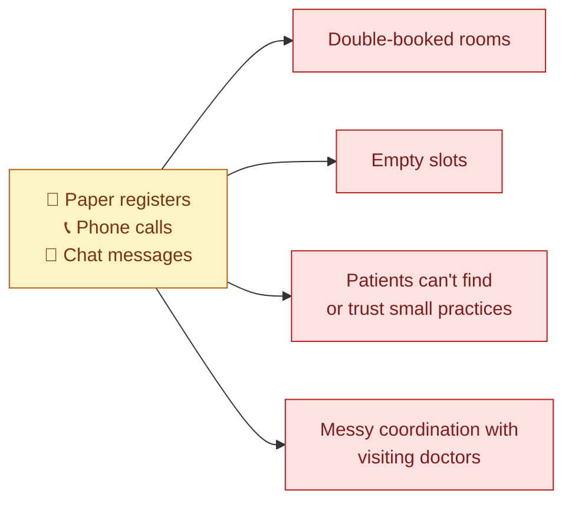
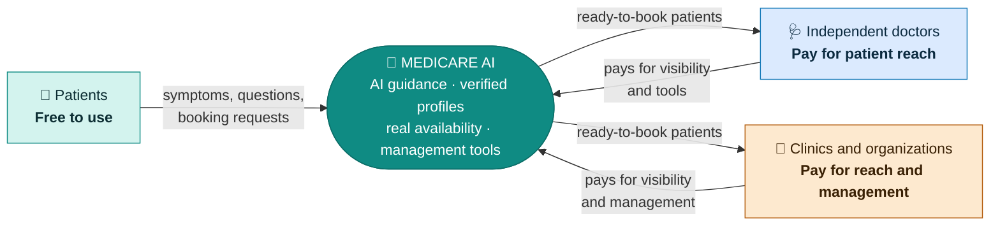
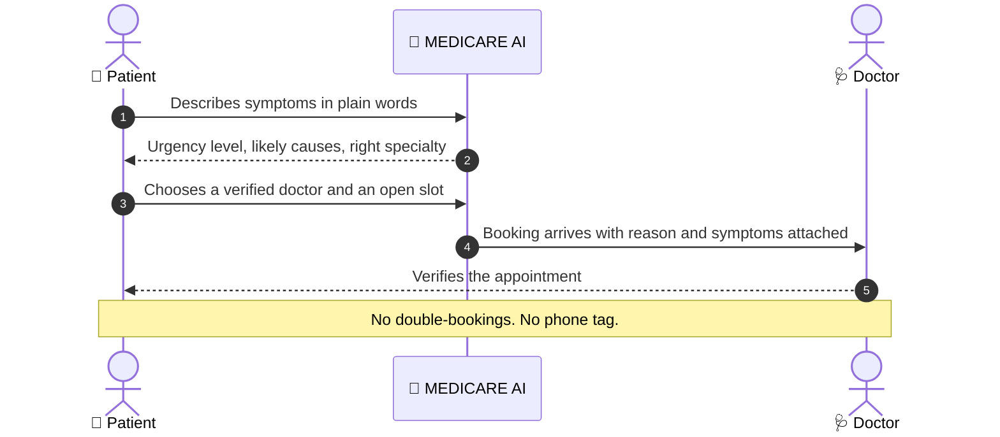
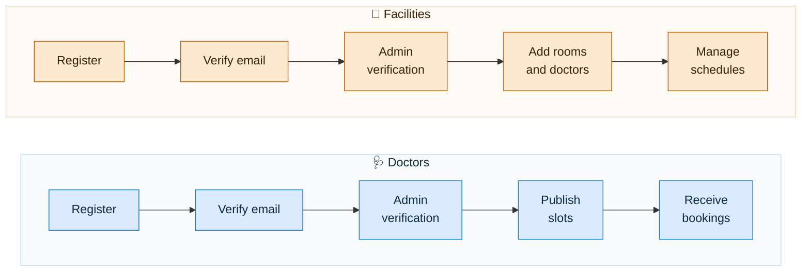
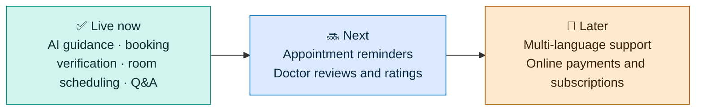

# 🏥 MEDICARE AI

**Affordable practice and facility management for independent doctors and small healthcare organizations, with AI-guided patients delivered to their door.**

[🌐 Live demo](https://medicare-ai-gules.vercel.app/) &nbsp;·&nbsp; [🩺 For doctors](https://medicare-ai-gules.vercel.app/doctor) &nbsp;·&nbsp; [🏢 For facilities](https://medicare-ai-gules.vercel.app/organization)

---

## 🎯 The problem

Most healthcare software is built for large hospital chains. For an independent doctor or a small clinic it is too expensive, too complicated and far more than they need. So they fall back on phone calls, paper registers and chat messages.

Patients face the other side of the same problem: unclear symptoms, no way to tell who is a verified doctor, and no idea which slots are really open.

## 💡 The solution

MEDICARE AI is one platform where patients, doctors and facilities meet.

- **Patients** describe how they feel, get AI-guided advice on urgency and the right specialty, and book a real, verified slot.
- **Independent doctors** get a professional profile, a steady flow of patients who are ready to book, and a simple dashboard instead of a notebook.
- **Small clinics and organizations** get the tools to manage rooms, schedules and visiting doctors without paying for an enterprise system.

## 👥 Who it is for

| Audience | What they get | How it works commercially |
| --- | --- | --- |
| 🧑 **Patients** | Free AI symptom guidance, verified doctors, real appointment slots, free expert Q&A | Free to use |
| 🩺 **Independent doctors** | A verified profile, visibility to patients actively looking for care, appointment management | Doctors pay to be listed and to reach new patients |
| 🏢 **Clinics, hospitals and medical centres** | Room scheduling, doctor affiliations and day-to-day management at a fraction of enterprise software cost | Organizations pay for management tools and patient reach |

Patients are the audience. Doctors and facilities are the customers who get paid-for value from reaching them and running their operations in one place.

## 🔄 From "I feel unwell" to a confirmed visit

## ✨ What it does

### 🧑 For patients
- Chat with an **AI health assistant** and run an **AI symptom check** that returns an urgency level, likely causes and the specialty to see.
- Find **admin-verified doctors** and facilities and book from **real availability**.
- Ask health questions and read answers from verified doctors in a free **Q&A** section.

### 🩺 For doctors
- Build a trusted profile verified by our admin team.
- Publish consultation hours and receive bookings that arrive with the patient's reason and symptoms attached.
- Confirm or decline appointments from one dashboard.
- Join facilities and request room time, and answer public questions to build a reputation.

### 🏢 For facilities
- Set up consultation rooms and departments and publish room availability.
- Approve the doctors who practise with you.
- Rooms are booked fairly on a first-come, first-served basis, so **two doctors can never get the same room at the same time**.
- See bookings, requests and appointments in one place.

### 🛡️ Trust and safety
- Every doctor and facility is **verified by an admin** before patients see them.
- Separate, protected access for patients, doctors, facilities and administrators.
- Email verification and secure password recovery.
- Clear guidance that the AI is informational only and is not for emergencies.

## 🚀 Getting started is quick

## 🏆 Why it stands out

- **Built around a real gap.** It serves small practices that existing software overlooks, with a clear way to pay for itself.
- **Both sides of the market.** Patients bring demand, and doctors and facilities get value, which gives the platform a natural growth loop.
- **Reliable by design.** Scheduling is built so bookings never collide, and expired appointments are cleaned up automatically.
- **Responsible AI.** It helps patients decide what to do next, while keeping real doctors at the centre of care.
- **Complete product, not a demo.** Four user roles, verification workflows, email delivery, Q&A and live deployment.

## 🧰 Built with

React · Node.js · MongoDB · Google Gemini AI

## 🗺️ Roadmap

## ⚠️ Disclaimer

MEDICARE AI provides general health information only. It does not replace advice, diagnosis or treatment from a qualified doctor, and it is not for emergencies. In an emergency, call your local emergency number.

---

Built by **Aritra Ray**

